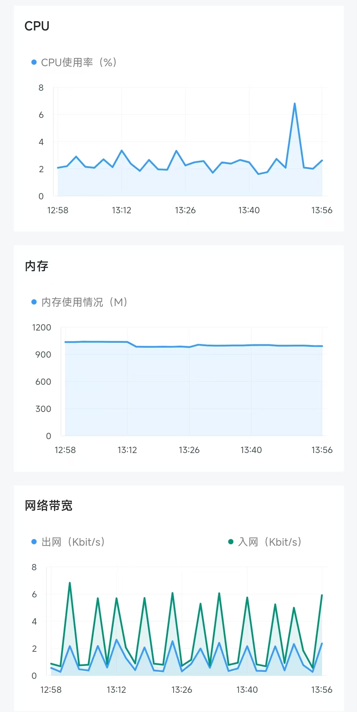

# Stories

[](https://github.com/klwy9768/stories/actions/workflows/ci.yml)

**English** | [简体中文](README.zh-CN.md)

A **self-hosted multi-persona AI chat app**: Flutter client + FastAPI backend.

Characters can chat one-on-one, join group chats, post to a Moments feed, and reach out on their own.
The backend adds long-term memory with vector retrieval, emotion-aware TTS with caching, multi-provider
model routing (DeepSeek / Doubao / MiniMax), an admin console, and server-hosted mini apps
(ledger, todo, anniversaries, radio, weather).

> This repository is **framework code**: it contains no user data, model keys, signing keys, or third-party art assets.
> Character personas and prompts are configured by the operator in the admin console.

**All built-in prompts have been compliance-reviewed.** You may modify them for your own use, but you
must comply with local laws; all consequences of modification and use are borne by the user.

**The UI and interaction model are deliberately WeChat-inspired** — conversation list, chat bubbles,
Moments, mini apps, emoji panel, WeChat green, and more. See
[UI & Interaction](#ui--interaction-wechat-inspired). This project is **not affiliated with Tencent or WeChat** in any way.

**Author**: 刘晨宇 · [github.com/klwy9768/stories](https://github.com/klwy9768/stories)

**Runs on a single 1-core / 1.5 GB server with 5 GB of disk** — no GPU, Redis, message queue, or vector database. The database is one SQLite file.

**Preview build**: an Android pre-release with bundled sample data and no backend connection, intended solely for UI and interaction preview.
Download: [Stories-demo-20261102.apk](https://github.com/klwy9768/stories/releases/download/demo-20261102/Stories-demo-20261102.apk)

---

## Features

| Module | Capability |
|---|---|
| Direct chat | Multi-persona dialogue, streaming polling, multi-bubble replies, voice/image/video/stickers, `[wait:N]` to simulate stepping away |
| Group chat | Multiple characters per group, a decision model picks who speaks and whether to speak, character-to-character chatter, dead-chat revival, quiet hours |
| Moments | Characters post automatically, comment, reply, and like |
| Proactive messages | Characters start a conversation after a period of silence (timing and topic chosen by a model) |
| Long-term memory | Automatic ingestion, hybrid vector + keyword retrieval, time decay, reranking, proactive recall, forgetting curve |
| Voice | TTS with 8 emotions and voice tuning, mixed text/voice delivery, quota control, content-hash cache |
| Media | Image/video generation, image captioning, video understanding, speech transcription |
| World state | Shared public events across characters (prevents contradictory knowledge) |
| Mini apps | Server-hosted HTML apps (weather/ledger/todo/anniversary/radio/balance), ticket auth, KV and event storage, no app release needed |
| Admin console | Characters, messages, groups, Moments, memory, settings, logs |
| Operations | Daily/weekly/monthly backups, object-storage archive, restore drills, upstream failure degradation |

---

## Tiny footprint, tiny bill

This project deliberately **avoids heavy infrastructure**: no Redis, no message queue, no vector database,
no GPU. The database is a single SQLite file.

| Resource | Minimum | Recommended | Notes |
|---|---|---|---|
| CPU | **1 core** | 2 cores | Single process + thread pool; most time is spent waiting on model APIs |
| RAM | **1.5 GB** | 2 GB | ~1 GB measured with long-term chat; grows with the number of characters |
| Disk | **5 GB** | 20 GB+ | Image ~250 MB; OS + Docker ~2 GB; chat media grows with use |
| Database | none (SQLite built in) | — | No separate MySQL / PostgreSQL |
| Cache | none | — | In-memory cache + local file cache |
| GPU | not needed | — | Every model is called over an API |
| Extra services | none | object storage (optional) | Only for backup archives |

**Cost reference**:

- A 1-core / 1.5 GB VPS with 5 GB of disk is enough; typical price is around **$2–5 / month**, and some providers offer free tiers;
- The main cost is **pay-per-use model APIs** — idle means no charge;
- Backups can go to object storage for cents per month;
- No database, cache, or GPU bills.

In short: **the cheapest cloud server plus pay-as-you-go APIs is all it takes to run this long-term.**

---

## Long-running behavior

A real one-hour sample from a 2-core / 1.8 GB server under normal chat load (long polling included).
The data comes from **long-term real usage**, not a stress test or an empty database.

| Metric | Observed | Notes |
|---|---|---|
| CPU | 2–3%, peak < 8% | Chat barely moves it; most time is spent waiting on model APIs |
| Memory | ~950–1000 MB total, flat | The app itself is ~500 MB; the rest is Docker, cloud agents, and the OS |
| Network | inbound peaks ~7 Kbit/s, outbound ~2 Kbit/s | Small periodic traffic from long polling |



*One hour of CPU, memory, and network monitoring under normal chat load (long polling included).*

**Where the memory goes**: app ~500 MB (about 150 MB of it is knowledge/memory vector caches),
Docker ~190 MB, cloud security/monitoring agents ~150 MB, OS and nginx ~150 MB.

**More characters, more memory**: each character with ~900 knowledge chunks adds roughly 30–50 MB
of resident memory. This scale fits comfortably in 1.5–2 GB; for significantly more characters,
budget around 50 MB per character.

This is the **typical state for long-term personal chat use** — CPU and memory stay flat, chat adds
very little variance, and nothing creeps upward over time. These numbers come from a real deployment,
not a stress test; they do not apply to high-concurrency or multi-user scenarios (see
[Commercial and multi-user use](#commercial-and-multi-user-use-important)).

---

## UI & Interaction: WeChat-Inspired

The client deliberately imitates WeChat's visuals and interaction patterns so users need zero learning time.

| WeChat element | Implementation here |
|---|---|
| Conversation list: pinning, unread dots, last message and time | `app/lib/main.dart` home list |
| Chat bubbles, time separators, voice bars, long-press menu | `app/lib/pages/chat_page.dart` |
| Emoji panel: category tabs, search, recent, backspace | `app/lib/emoji_panel.dart` + `emoji_data.dart` |
| Moments: 9-grid images, likes, comments, replies | `app/lib/pages/moments_page.dart`, `character_moments_page.dart` |
| Mini-app center: search, recently used, my apps | `app/lib/miniapps/miniapps_page.dart` |
| WeChat green `#07C160`, four bottom tabs, white card groups | `app/lib/main.dart` theme |
| Album / camera pickers | Open-source `wechat_assets_picker`, `wechat_camera_picker` |
| Mini games: jump, 2048, match-3, shooter | `app/lib/games/` |
| Contact-style "chat-only friends" and "group chats" entries | `app/lib/main.dart` |

**Boundaries**:

- This project is **not** an official Tencent or WeChat product and has **no affiliation** with Tencent;
- No proprietary WeChat assets are used: icons are drawn in code (`app/lib/wechat_icons.dart`),
  images come from the open-source packages below or from the operator;
- "WeChat" and "微信" are trademarks of Tencent; they appear here only to describe the **design reference**;
- The app presents itself as **Stories** (launcher label, title bar, first tab is "Chat"), never as "WeChat";
- The imitation covers interaction habits and layout only, not WeChat's protocols, account system,
  or any closed-source implementation.

---

## Architecture

```
┌─────────────────────────────┐
│      Flutter App (Android)  │
│  Chat / Groups / Moments /  │
│         Mini apps           │
└──────────────┬──────────────┘
               │ HTTPS  X-App-Token
┌──────────────▼──────────────┐
│            nginx            │  TLS termination, /admin Basic auth, reverse proxy
└──────────────┬──────────────┘
               │ 127.0.0.1:8001
┌──────────────▼──────────────────────────────────────────┐
│                FastAPI (single process + thread pool)   │
│                                                         │
│  main.py      routes / message queue / group scheduling │
│               / Moments / admin API                     │
│  ai.py        model routing / system prompts / groups   │
│               / proactive messages / decisions          │
│  memory_kb.py ingestion · hybrid retrieval · decay      │
│  media.py     TTS / image / video / vision / transcribe │
│  news.py      news fetch & cleaning                     │
│  knowledge.py KB chunking · vectors · rerank            │
│  db.py        SQLite (WAL) data layer                   │
└──────────────┬──────────────────────────────────────────┘
               │
    ┌──────────┴───────────┬───────────────┬──────────────┐
    ▼                      ▼               ▼              ▼
 SQLite                local media      DashScope      DeepSeek / Doubao /
 stories.db        media/ uploads/   vectors + rerank  MiniMax (voice/video)
```

**Design choices**: one machine, one process, SQLite — simple enough to operate and replace.
Every external dependency is swappable: models go through the unified `ai._call_model` routing layer,
and storage uses local directories.

---

## Repository layout

```
backend/                 Backend
├── main.py              FastAPI entry: routes, message loop, group/Moments scheduling, admin API
├── ai.py                Model calls and all prompts: system prompt, groups, proactive, memory, segmentation
├── db.py                SQLite layer (schema, characters/messages/groups/Moments/settings/memory)
├── memory_kb.py         Long-term memory: ingestion rules, embeddings, hybrid retrieval, decay, forgetting
├── media.py             TTS, image/video generation, image captioning, video understanding, transcription
├── knowledge.py         Knowledge base: chunking, embeddings, rerank, two-tier retrieval
├── news.py              News: search, fetch, body cleaning
├── mailer.py            Optional email notifications (SMTP, off by default)
├── mini_balance.py      Mini-app backend: ledger
├── mini_weather.py      Mini-app backend: weather
├── parser.py            Text parsing helpers
├── logger.py            Logging (file + in-memory ring buffer)
├── secrets_cfg.py       Secret loading (env vars > local JSON)
├── admin/index.html     Admin console (single page)
├── miniapps/            Mini apps (HTML + JS, server-hosted)
└── test_*.py            Regression tests

app/                     Flutter client
├── lib/
│   ├── main.dart        Entry point and home
│   ├── api.dart         HTTP wrapper, URL tickets
│   ├── secrets.dart     Access token (empty in this repo; fill it in)
│   ├── local_db.dart    Local cache
│   ├── pages/           Chat, groups, Moments, memory, settings…
│   ├── miniapps/        Mini-app WebView container
│   └── games/           Built-in mini games
├── android/             Android project (signing config is yours to create)
└── pubspec.yaml
```

---

## Message lifecycle

1. App calls `POST /api/chat/send` (with `X-App-Token`)
2. `main.chat_send()` stores the user message → enqueues a `pending_tasks` job
3. The background loop `_process_one()` picks it up:
   - `ai.build_system()` assembles the system prompt (static rules first, dynamic blocks next, time block last)
   - `memory_kb.retrieve()` fetches long-term memories → injected as "important things you remember"
   - Extra instructions: web search results, reminder plugin (off by default, needs prompts), etc.
   - `ai._call_model()` routes to the right provider (DeepSeek / Doubao / xAI)
4. `ai._parse_model_reply()` parses the JSON: `reply` / `photo_prompt` / `voice` / `sticker` / `video_prompt` / `group_msg`
5. `main._dispatch_reply()` fans out: text to the segment queue, photos/videos to media generation
6. `ai.split_segments()` splits the reply into multiple bubbles (model + rule fallback)
7. Each bubble is written to `pending_tasks`; the app picks them up via `/api/chat/messages?wait=true`
8. Memory is ingested asynchronously: `memory_kb.index_scope()` decides → embeds → persists

---

## Memory system

| Stage | Implementation |
|---|---|
| Ingestion | A judge model filters "completely worthless" messages → batch embeddings → base64 float32 stored in `vectors/` |
| Retrieval | Optional query expansion → cosine similarity ∪ Chinese bigrams → time decay → rerank (when candidates ≥ threshold) → Top-N |
| Isolation | Direct-chat and group memories use separate scopes; group chat never sees private memories |
| Proactive recall | A scheduled job brings old memories back at suitable moments |
| Forgetting | Memories older than `forget_days` with low weight decay and are cleaned up |

Dependencies: `qwen3.7-text-embedding` (vectors) + `qwen3-vl-rerank` (rerank), both replaceable.

---

## Group chat

```
User group message → is it worth replying to? (deterministic rules + decision model)
                   → who should answer? (per-character probability)
                   → generate 1–2 replies (at most 2 speakers for questions/@mentions)
                   → character-to-character chain (up to N rounds)
```

A background cadence (idle time + decision interval + daily quota + quiet hours) controls how often
characters speak up on their own.

---

## Mini apps (server-hosted)

Six built-in life apps: weather, ledger, todo, anniversaries, radio, balance.

They are all **server-hosted HTML pages**; the app only provides a WebView container.
Adding or changing a mini app **does not require an app release** — restart the backend and it is live.

### Layout

```
backend/miniapps/
├── manifest.json            Manifest: id / name / icon / color / description
├── common/sdk.js            Shared SDK: ticket injection + API wrapper
├── common/style.css         Shared styles
├── weather/index.html       Weather (two cities, rain alerts)
├── ledger/index.html        Ledger (quick entries, monthly summary)
├── todo/index.html          Todo list
├── anniversary/index.html   Anniversary countdown
├── radio/index.html         External radio
└── balance/index.html       Provider balances
```

On launch the app requests `GET /api/miniapps` for the manifest, then loads
`/miniapps/<id>/index.html?token=<ticket>`.

### Auth flow

```
App long-lived token
   │  GET /api/ticket
   ▼
12-hour ticket (HMAC-SHA256, key generated and persisted automatically)
   │
   ▼
/miniapps/<id>/index.html?token=ticket
   │
   ▼
sdk.js: token in query, also sent as X-App-Token header
   │
   ▼
Ticket only grants /media/, /uploads/, /api/mini/
```

- Tickets expire after **12 hours**; the app renews them automatically;
- A ticket is not the long-lived token: even if a page URL is screenshotted or shared, it only reaches
  media files and mini-app endpoints while valid;
- Tickets **cannot** reach `/api/bootstrap`, chat endpoints, or the admin API — anything outside the
  allow-list is rejected;
- The ticket key is generated randomly on first start and stored on disk (`data/ticket_secret`);
  it is never in source code and survives restarts.

### Available endpoints

| Endpoint | Method | Description |
|---|---|---|
| `/api/mini/chars` | GET | Character `id` + name, so mini apps can pick "who to talk to" |
| `/api/mini/kv` | GET / POST | Key-value store, isolated per `app`; 200 KB per value, oversized writes **fail loudly** instead of being silently truncated |
| `/api/mini/events` | GET / POST | Event stream (ledger / todo / anniversary), optionally per character; identical content deduplicated within 90 s, auto-cleaned after 7 days |
| `/api/mini/weather` | GET | City weather |
| `/api/mini/balance` | GET | Provider balances (60 s cache, 10 s anti-spam) |

### Build your own mini app

1. Create `backend/miniapps/<id>/index.html` and include `../common/sdk.js`;
2. Add an entry to the `apps` array in `manifest.json` (id / name / icon / color / description);
3. Use `MINI.kvGet / kvSet / event / weather / api` from the page;
4. Restart the backend — no app update needed.

Minimal example:

```html
<script src="../common/sdk.js"></script>
<script>
  MINI.kvGet('memo', 'today').then(function (r) {
    document.body.textContent = r.value || 'No entry yet';
  });
</script>
```

### Security boundaries

- The WebView only allows same-origin HTTPS navigation (`localhost` / emulator addresses are allowed
  for local debugging); `javascript:`, `file:`, `data:`, and external domains are blocked;
- Pages never receive the app's long-lived token, and cannot read another app's KV data (isolated by `app`);
- `chars` returns only ids and names — never personas, memories, or chat content.

---

## Deployment

### 0. Prerequisites

- A Linux server (**1 core / 1.5 GB RAM / 5 GB disk is enough**)
- Docker 20.10+
- A domain name (optional; IP + self-signed cert works for testing)

### 1. Clone

```bash
git clone https://github.com/klwy9768/stories.git
cd stories
```

### 2. Environment file

Create `secrets.env` (**never commit it**):

```ini
STORIES_APP_TOKEN=<32-char random hex>
ADMIN_PASSWORD=<admin password>
DEEPSEEK_API_KEYS=<your key>
ARK_API_KEY=<your key>
DASHSCOPE_API_KEY=<your key>
MINIMAX_API_KEY=<your key>
MINIMAX_GROUP_ID=<your group id>
```

Generate a token:

```bash
openssl rand -hex 16
```

### 3. Build and run

```bash
docker build -t stories-server .

docker run -d --name stories-server \
  --restart unless-stopped \
  -p 127.0.0.1:8001:8001 \
  -v /srv/stories/data:/app/data \
  --env-file ./secrets.env \
  stories-server
```

All data lives in `/srv/stories/data`; deleting the container does not lose anything.

Health check:

```bash
curl -s http://127.0.0.1:8001/api/app_version
```

### 4. Reverse proxy and HTTPS

nginx example (replace `example.com`):

```nginx
server {
    listen 443 ssl http2;
    server_name example.com;

    ssl_certificate     /etc/letsencrypt/live/example.com/fullchain.pem;
    ssl_certificate_key /etc/letsencrypt/live/example.com/privkey.pem;

    client_max_body_size 100m;

    location / {
        proxy_pass http://127.0.0.1:8001;
        proxy_set_header Host $host;
        proxy_set_header X-Real-IP $remote_addr;
        proxy_read_timeout 300s;   # long polling needs a longer read timeout
    }

    # extra Basic auth layer for the admin console
    location /admin {
        auth_basic "admin";
        auth_basic_user_file /etc/nginx/.htpasswd;
        proxy_pass http://127.0.0.1:8001;
    }
}
```

Issue a certificate:

```bash
sudo certbot --nginx -d example.com
```

> The public client **only trusts system CAs**, so use a real certificate (Let's Encrypt is fine).
> If you insist on a self-signed certificate, you must restore the client's trust logic yourself.

### 5. Build the client

```bash
cd app
# 1) set your server address in lib/api.dart, lib/log.dart, lib/notif.dart
# 2) set the access token in lib/secrets.dart
# 3) configure signing: cp android/key.properties.example android/key.properties
flutter pub get
flutter build apk --release
```

Output: `build/app/outputs/flutter-apk/app-release.apk`

Drop the APK into the server's `uploads/` directory and it is served at `/uploads/Stories.apk` for in-app updates.

### 6. Upgrade and rollback

```bash
# upgrade
git pull
docker build -t stories-server:new .
docker stop stories-server && docker rm stories-server
docker run -d --name stories-server --restart unless-stopped \
  -p 127.0.0.1:8001:8001 -v /srv/stories/data:/app/data \
  --env-file ./secrets.env stories-server:new

# rollback: switch back to the old tag
docker run -d --name stories-server --restart unless-stopped \
  -p 127.0.0.1:8001:8001 -v /srv/stories/data:/app/data \
  --env-file ./secrets.env stories-server:old
```

Schema migrations run automatically at startup and are additive (new columns/tables), so existing data stays intact.

---

## Disaster recovery & backup

### Data safety baseline

| Measure | Details |
|---|---|
| SQLite WAL | `journal_mode=WAL` + `busy_timeout=5000` + `synchronous=NORMAL`; the log replays after a crash |
| Single volume | Database, media, vectors, and uploads all live on the mounted volume; the container can be rebuilt anytime |
| Fail-fast startup | The service refuses to start without `STORIES_APP_TOKEN` — it never runs unauthenticated |
| Schema migrations | `ALTER TABLE` / table creation on startup; old databases upgrade in place |
| Ticket key | Generated and persisted automatically; survives restarts and never appears in source |

### Backup strategy (reference)

| Frequency | Content | Retention |
|---|---|---|
| Daily 03:00 | `stories.db` + config snapshot | 30 days |
| Sunday 04:00 | Full (database + media + vectors + uploads) | 90 days |
| 1st of month, 04:30 | Full archive | Forever |

- Backups go to a **private** object-storage bucket with versioning enabled; only recent copies stay on the server;
- Lifecycle rules expire old backups automatically so storage costs do not creep;
- Media directories are **incrementally synced** (about every 5 minutes), cutting RPO from a day to minutes;
- Times and retention are examples — tune them to your data size.

### Restore drills

A backup you never restore is not a backup. Do this quarterly:

1. Download the latest full backup to a temporary directory;
2. Start a throwaway container on another port with that directory as the data volume;
3. Check: character count, the last 20 messages, media accessibility, mini-app KV reads, memory retrieval;
4. Destroy the temporary container once verified.

### Degradation under upstream failures

| Scenario | Behavior |
|---|---|
| Primary model key exhausted / rate-limited | Multi-key rotation with cooldown, automatic fallback to a backup model |
| Embedding / rerank service down | Memory retrieval falls back to keyword matching; replies are not blocked |
| TTS upstream failure | Content-hash cache is reused when possible; otherwise this message is text-only |
| News fetch failure | News is skipped; chat is unaffected |
| Object storage unavailable | Backup jobs fail, but the app keeps running (local volume is writable); monitor job exit codes yourself |

### Upgrade & rollback

- Keep images by version; rollback means switching the image tag and restarting;
- Migrations are mostly **additive** (new columns/tables), so old code can still read the new database;
- Pause writes (stop the container) before a rollback to avoid half-written state.

---

## Configuration

Secret priority: **environment variables > `~/.stories_secrets.json` > `backend/secrets.local.json` > `data/secrets.json`**.

| Variable | Description |
|---|---|
| `STORIES_APP_TOKEN` | App access token (**required**; the service refuses to start without it) |
| `ADMIN_PASSWORD` | Admin console password |
| `DEEPSEEK_API_KEYS` / `DEEPSEEK_BASES` | DeepSeek API keys (multiple keys supported) |
| `ARK_API_KEY` | Volcengine Ark (Doubao) key |
| `DASHSCOPE_API_KEY` / `DASHSCOPE_HOST` | Embeddings, rerank, judge models |
| `MINIMAX_API_KEY` / `MINIMAX_GROUP_ID` | TTS and video generation |
| `ALIYUN_AK` / `ALIYUN_SK` | Balance queries (optional) |

---

## Email notifications (optional)

Sends backup results or scheduled-task failures to an inbox. **Disabled by default.**

1. Copy the template into your data directory:

```bash
cp backend/mail_self.conf.example /path/to/data/mail_self.conf
```

2. Fill in `SMTP_HOST` / `SMTP_PORT` / `SMTP_USER` / `SMTP_PASS` (app-specific password)
   and `TO` (recipients).
3. Send:

```bash
cd backend
python mailer.py "Backup failed" "Job exited with code 1 on 2026-11-02"
```

If `SMTP_PASS` or `TO` is empty the feature is disabled and no connection is attempted.
The config file contains a password and is listed in `.gitignore` — never commit it.

Or call it from code:

```python
import mailer
mailer.send("Subject", "Body")
```

---

## Development & tests

```bash
cd backend
python test_smoke.py        # smoke tests
python test_security.py     # token / ticket / upload / mini-app KV regressions
python test_full_chain.py   # end-to-end
python test_memory.py       # memory system
python test_media.py        # media (offline stubs by default; RUN_MEDIA_API=1 for live calls)
python test_admin.py        # admin API
python test_logging.py      # logging (including secret redaction)
```

Tests use temporary data directories and never touch production data. `test_media.py` is offline
by default; set `RUN_MEDIA_API=1` to hit the real image/TTS APIs.

---

## Open-source components & credits

This project stands on the following open-source work. The in-app "Settings → Open-source licenses"
page lists the same set.

### Client (Flutter / Dart)

| Component | License | Purpose |
|---|---|---|
| [Flutter](https://github.com/flutter/flutter) / Dart | BSD-3-Clause | Cross-platform framework and runtime |
| [wechat_assets_picker](https://github.com/fluttercandies/flutter_wechat_assets_picker) | Apache-2.0 | WeChat-style gallery picker |
| [wechat_camera_picker](https://github.com/fluttercandies/flutter_wechat_camera_picker) | Apache-2.0 | WeChat-style camera |
| [photo_manager](https://github.com/fluttercandies/flutter_photo_manager) | Apache-2.0 | Gallery access |
| [video_player](https://github.com/flutter/packages) | BSD-3-Clause | Video playback |
| [audioplayers](https://github.com/bluefireteam/audioplayers) | MIT | Voice message playback |
| [record](https://github.com/llfbandit/record) | BSD-3-Clause | Audio recording |
| [flutter_local_notifications](https://github.com/MaikuB/flutter_local_notifications) | BSD-3-Clause | Local notifications |
| [flutter_background_service](https://github.com/ekasetiawans/flutter_background_service) | MIT | Background keep-alive (long polling) |
| [webview_flutter](https://github.com/flutter/packages) | BSD-3-Clause | Mini-app WebView container |
| [shared_preferences](https://github.com/flutter/packages) | BSD-3-Clause | Local key-value storage |
| [path_provider](https://github.com/flutter/packages) | BSD-3-Clause | App sandbox directories |
| [path](https://github.com/dart-lang/path) | BSD-3-Clause | Path handling |
| [http](https://github.com/dart-lang/http) | BSD-3-Clause | HTTP client |
| [crypto](https://github.com/dart-lang/crypto) | BSD-3-Clause | Hashing (file checksums) |
| [convert](https://github.com/dart-lang/convert) | BSD-3-Clause | Encoders/decoders |
| [image_picker](https://github.com/flutter/packages) | Apache-2.0 | System camera/gallery (fallback) |
| [file_picker](https://github.com/miguelpruivo/flutter_file_picker) | MIT | File picking |
| [open_filex](https://github.com/crazecoder/open_file) | MIT | Open downloaded APKs/files |
| [qr_flutter](https://github.com/theyakka/qr.flutter) / [qr](https://github.com/kevmoo/qr.dart) | BSD-3-Clause / Apache-2.0 | QR codes |
| [cupertino_icons](https://github.com/flutter/cupertino_icons) | MIT | iOS-style icons |
| [flutter_launcher_icons](https://github.com/fluttercommunity/flutter_launcher_icons) (dev) | MIT | Launcher icon generation |
| [flutter_lints](https://github.com/flutter/packages) (dev) | BSD-3-Clause | Lint rules |
| Material Icons | Apache-2.0 | Icon font |

**Vendored plugin**:

| Component | License | Notes |
|---|---|---|
| `flutter_background_service_android` 6.3.1 | MIT © 2022 Eka Setiawan Saputra | Lives in `app/plugins/`; patched here for background keep-alive; original license in that directory's `LICENSE` |

### Server (Python)

| Component | License | Purpose |
|---|---|---|
| [FastAPI](https://github.com/fastapi/fastapi) | MIT | Web framework |
| [Uvicorn](https://github.com/encode/uvicorn) | BSD-3-Clause | ASGI server |
| [Pydantic](https://github.com/pydantic/pydantic) | MIT | Request/response models |
| [python-multipart](https://github.com/Kludex/python-multipart) | Apache-2.0 | Form and upload parsing |
| [NumPy](https://github.com/numpy/numpy) | BSD-3-Clause | Vector storage and cosine similarity |
| [httpx](https://github.com/encode/httpx) | BSD-3-Clause | HTTP client (also used by tests) |
| [opencc-python-reimplemented](https://github.com/yichen0831/opencc-python) | Apache-2.0 | Simplified/Traditional Chinese conversion (Python port of OpenCC) |

### Third-party services (not open source)

The **code and models of these services are not in this repository**; they are called over APIs.
Using them means accepting their terms and paying their fees.

| Service | Purpose |
|---|---|
| DeepSeek platform | Main chat models, web search API |
| Volcengine Ark (Doubao) | Main chat, judging, vision, speech transcription |
| Alibaba Cloud DashScope | Text embeddings, rerank |
| MiniMax | TTS, video generation |
| anysearch (optional) | Fallback web-search channel |
| Alibaba Cloud SMS / billing APIs (optional) | Mini-app balance queries |

### Design references

The **implementation ideas** for refusal scrubbing, reply segmentation, proactive messages, web-search
injection, and memory retrieval draw on public prompt-engineering practice and the author's earlier
private versions. All code in this repository is a reimplementation; no code or assets from those
sources are included.

The built-in mini games are original implementations as well; their gameplay corresponds to classic
games: 2048 (original by Gabriele Cirulli, MIT), "Jump", match-3, and a vertical shooter. None of their
code, images, or audio is used.

---

## Known limitations

- Single machine, single process — no horizontal scaling (SQLite + in-process queue)
- The admin console uses one shared password, not multi-user accounts
- No built-in TLS — put nginx/Caddy in front
- Model providers require your own keys, and you pay for usage
- No character personas or assets are bundled; create your own

---

## Commercial and multi-user use (important)

This project is released under the **MIT license**, which permits commercial use, modification,
and redistribution. However:

**The current architecture is not suitable for direct multi-user commercial deployment (SaaS).**

| Limitation | Details |
|---|---|
| Single machine, single process | SQLite + in-process queue; no horizontal scaling, and multiple instances would contend for the same database file |
| No tenant isolation | All characters, messages, and memories live in one dataset; there is no "user" concept, so data cannot be isolated per tenant |
| Single admin password | The admin console uses one shared password, not an account system |
| No billing or quotas | No subscriptions, quotas, invoices, or rate limiting; the operator pays for all model usage |
| No audit or compliance tooling | No operation audit log, retention policy, or real-name verification |

For a multi-user commercial product you would need to replace the database (PostgreSQL/MySQL),
add a real message queue, implement tenant isolation and authentication, add billing and rate limiting,
and build audit/compliance features. That is a substantial rewrite — **do not ship this version to
external users as-is**.

Single-user use, family or small-team internal use, and prototyping are all fine.

---

## Content policy

This repository provides a **framework** only; it ships no character prompts, personas, or corpora.

| Item | Default state | Notes |
|---|---|---|
| Reminder plugin | **Prompts and keywords are empty; the feature is disabled** | Fill in the judge prompt, reminder prompt, and keywords under "Settings → Reminder"; if any is empty, nothing is injected into the model |
| Character personas, knowledge base, corpora | **Empty** | Created and imported by the operator |
| Built-in mini games / mini apps | Neutral | Ledger, todo, anniversaries, radio, weather |

**Why empty by default**: prompts are business content and vary widely between use cases, so they are
better left to each operator — and each operator is responsible for what they configure.

**All built-in prompts have been compliance-reviewed**: the system prompts, memory extraction,
segmentation, and group-chat templates in this repository have been neutralized and reviewed for
compliance, and contain no unlawful or explicit content. You may modify the prompts for your own use,
but **you must ensure that your modified content complies with local laws and the terms of the model
services you use**. All consequences arising from modification or use are borne by the user.

**Operator responsibilities**:

- Ensure configured character content and generated content comply with local law;
- Ensure compliance with the terms of the model services you call (DeepSeek / Volcengine Ark / DashScope / MiniMax, etc.);
- If you offer the service to others, handle content moderation, real-name verification, and filings as required.

The author is not responsible for content configured by operators or its consequences.

## Disclaimer

This project is for technical learning and personal use. All built-in prompts have been
compliance-reviewed; operators bear full responsibility for any modifications to those prompts and
for the content and consequences arising from them. Operators must ensure their configured
character content, generated content, and usage comply with local law and the terms of the model
services they call. The author is not responsible for operators' content or actions.

## License

[MIT](LICENSE)

Copyright (c) 2026 刘晨宇 · https://github.com/klwy9768/stories

> MIT permits commercial use, but the current architecture is not suitable for multi-user commercial
> deployment — see [Commercial and multi-user use](#commercial-and-multi-user-use-important).
