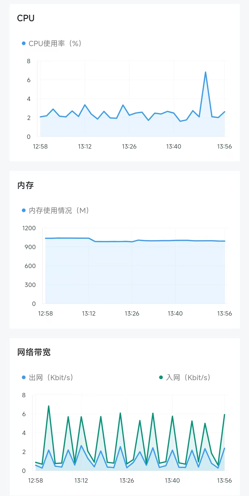

# Stories

[](https://github.com/klwy9768/stories/actions/workflows/ci.yml)

[English](README.md) | **简体中文**

一个**自托管的多角色 AI 聊天应用**：Flutter 客户端 + FastAPI 后端。

角色可以私聊、群聊、发朋友圈、主动联系；有长期记忆（向量检索）；语音合成带情绪识别与缓存；
支持多模型路由（DeepSeek / 豆包 / MiniMax）；管理后台与生活小程序（记账、待办、纪念日、电台、天气）。

> 本仓库是**框架代码**：不含任何用户数据、模型密钥、签名密钥或第三方美术素材。
> 角色人设、提示词等业务内容由使用者在后台自行配置。

**所有内置提示词均已做合规化处理**；使用者可以按需自行修改，但必须遵守所在地法律法规，
修改与使用产生的一切后果由使用者自行承担。

**界面与交互参照微信**：会话列表、聊天气泡、朋友圈、小程序、表情面板、微信绿等，详见下文
[界面与交互：参照微信](#界面与交互参照微信)。本项目与腾讯 / 微信官方**无任何关联**。

**作者**：刘晨宇 · [github.com/klwy9768/stories](https://github.com/klwy9768/stories)

**一台 1 核 1.5 GB、5 GB 磁盘的服务器就能跑**：不需要 GPU、Redis、消息队列或向量数据库，数据库就是一个 SQLite 文件。

**界面预览**：提供一个 Android 预览版本（pre-release），内置示例数据，不连接任何后端服务，仅用于界面与交互预览。
下载：[Stories-demo-20261102.apk](https://github.com/klwy9768/stories/releases/download/demo-20261102/Stories-demo-20261102.apk)

---

## 功能一览

| 模块 | 能力 |
|---|---|
| 私聊 | 多人格对话、流式轮询、多气泡分段、语音/图片/视频/表情、`[wait:N]` 模拟“离开一下” |
| 群聊 | 多角色同群、决策模型控制“谁说话/要不要说话”、角色间互聊、冷场复活、夜间免打扰 |
| 朋友圈 | 角色自动发圈、评论、回复评论、点赞 |
| 主动联系 | 沉默一段时间后主动开口（决策模型判定时机与话题） |
| 长期记忆 | 自动入库、向量 + 关键词混合检索、时间衰减、重排、主动回忆、遗忘曲线 |
| 语音 | TTS 合成（8 种情绪 + 音色微调）、分段混发、配额控制、内容哈希缓存 |
| 媒体 | AI 出图 / 出视频、图片转述、视频理解、语音转写 |
| 世界 | 跨角色共享的公开事件（防止角色之间见闻矛盾） |
| 小程序 | 服务端托管的 HTML 小应用（天气/记账/待办/纪念日/电台/余额），票据鉴权，可读写 KV 与事件，新增无需发版 |
| 管理后台 | 角色、消息、群聊、朋友圈、记忆、设置与日志 |
| 运维 | 每日 / 每周 / 每月三级备份、对象存储归档、恢复演练、上游故障降级 |

---

## 极低的资源占用与成本

这个项目刻意**不引入任何重型基础设施**：没有 Redis、没有消息队列、没有向量数据库、不需要 GPU，
数据库就是 SQLite 一个文件。

| 资源 | 最低配置 | 推荐配置 | 说明 |
|---|---|---|---|
| CPU | **1 核** | 2 核 | 单进程 + 线程池；大部分时间在等模型 API 返回 |
| 内存 | **1.5 GB** | 2 GB | 长期聊天实测整机约 1 GB；角色越多占用越高，按角色数酌情增加 |
| 磁盘 | **5 GB** | 20 GB 起 | 镜像约 250 MB，系统 + Docker 约 2 GB，聊天媒体随使用增长 |
| 数据库 | 无（内置 SQLite） | — | 不需要单独部署 MySQL / PostgreSQL |
| 缓存 | 无 | — | 内存缓存 + 本地文件缓存 |
| GPU | 不需要 | — | 所有模型都走 API |
| 依赖服务 | 无 | 对象存储（可选） | 仅用于备份归档 |

**成本参考**：

- 一台 1 核 1.5 GB / 5 GB 磁盘的最低配 VPS 就能跑，常见价格约 **¥10–30 / 月**，部分厂商还有免费额度；
- 主要开销是模型 API 的**按量计费**，不聊天就不产生费用；
- 备份可选对象存储，每月通常几毛到几块钱；
- 不需要为数据库、缓存、GPU 单独付费。

换句话说：**一台最便宜的云服务器 + 按量付费的 API，就能长期跑下去。**

---

## 长期运行表现

以下是一台 2 核 1.8 GB 服务器上、连续 1 小时正常聊天场景的实际监控（含长轮询）。
数据来自**长期积累的真实使用量**，不是压测或空库演示。

| 指标 | 观测值 | 说明 |
|---|---|---|
| CPU | 2%–3%，峰值 <8% | 聊天时也基本在这个区间，大部分时间在等模型 API 返回 |
| 内存 | 整机约 950–1000 MB，曲线平稳 | 应用本身约 500 MB，其余是 Docker、云厂商 agent 与系统 |
| 网络 | 入站峰值约 7 Kbit/s，出站约 2 Kbit/s | 长轮询产生的周期性小流量 |



*连续 1 小时的 CPU、内存与网络监控（正常聊天，含长轮询）*

**内存怎么分配**：应用约 500 MB（其中知识库与记忆的向量缓存约 150 MB）、Docker 约 190 MB、
云厂商安全监控组件约 150 MB、系统与 nginx 约 150 MB。

**角色越多，内存越高**：每个角色带约 900 条知识库时，常驻内存大约多 30–50 MB。
这个规模用 1.5–2 GB 足够；角色数量明显增加时，按每个角色 50 MB 左右预留。

结论：这是**长期聊天的典型状态**——CPU 和内存都很平，聊天带来的波动很小，也没有随时间爬升的迹象。
上面的数字来自真实部署，不是压测；高并发或多用户场景不适用（见[商用与多用户限制](#商用与多用户限制重要)）。

---

## 界面与交互：参照微信

客户端在**视觉与交互上刻意模仿微信**，目的是让用户零学习成本上手。

| 微信元素 | 本项目的实现 |
|---|---|
| 会话列表：置顶、未读红点、最后一条消息与时间 | `app/lib/main.dart` 首页列表 |
| 聊天气泡、时间分隔、语音条、撤回式长按菜单 | `app/lib/pages/chat_page.dart` |
| 表情面板：分类 Tab、搜索、最近使用、退格 | `app/lib/emoji_panel.dart` + `emoji_data.dart` |
| 朋友圈：九宫格图片、点赞、评论、回复 | `app/lib/pages/moments_page.dart`、`character_moments_page.dart` |
| 小程序中心：搜索、最近使用、我的小程序 | `app/lib/miniapps/miniapps_page.dart` |
| 微信绿 `#07C160`、底部四 Tab、白色卡片分组 | `app/lib/main.dart` 全局主题 |
| 相册 / 相机选择器 | 直接使用开源库 `wechat_assets_picker`、`wechat_camera_picker` |
| 小游戏：跳一跳、2048、三消、射击 | `app/lib/games/` |
| 通讯录式「仅聊天的朋友」「群聊」入口 | `app/lib/main.dart` |

**边界声明**：

- 本项目**不是**腾讯或微信的官方产品，与腾讯公司**无任何关联**，也未获得其授权或背书；
- 未使用微信的任何专有素材：界面图标为自绘（`app/lib/wechat_icons.dart`，原创路径），
  图片素材来自下述开源组件或由使用者自行提供；
- 「微信」「WeChat」是腾讯公司的商标，此处仅用于说明**设计参考来源**；
- App 自身显示的名称是 **Stories**（桌面图标、标题栏、底部首个 Tab 为「聊天」），
  不使用「微信」作为产品名或账号名；
- 模仿仅限于交互习惯与布局，不包含微信的通信协议、账号体系或任何闭源实现。

---

## 架构总览

```
┌─────────────────────────────┐
│      Flutter App (Android)   │
│  聊天 / 群聊 / 朋友圈 / 小程序 │
└──────────────┬──────────────┘
               │ HTTPS  X-App-Token
┌──────────────▼──────────────┐
│            nginx             │  TLS 终止、/admin Basic 认证、反代
└──────────────┬──────────────┘
               │ 127.0.0.1:8001
┌──────────────▼──────────────────────────────────────────┐
│                  FastAPI (单进程 + 线程池)                │
│                                                          │
│  main.py      路由 / 消息队列 / 群聊调度 / 朋友圈 / 管理端   │
│  ai.py        模型路由 / 系统提示词 / 群聊 / 主动联系 / 决策  │
│  memory_kb.py 记忆入库 · 混合检索 · 衰减 · 遗忘            │
│  media.py     TTS / 出图 / 出视频 / 视觉理解 / 转写        │
│  news.py      新闻抓取与清洗                              │
│  knowledge.py 知识库切片 · 向量 · 重排                     │
│  db.py        SQLite (WAL) 数据层                         │
└──────────────┬──────────────────────────────────────────┘
               │
    ┌──────────┴───────────┬───────────────┬──────────────┐
    ▼                      ▼               ▼              ▼
 SQLite               本地媒体目录      DashScope       DeepSeek / 豆包 /
 stories.db        media/ uploads/    向量 + 重排       MiniMax (语音/视频)
```

**设计取向**：单机、单进程、SQLite，够用且运维简单；所有外部依赖都可替换（模型走统一的
`ai._call_model` 路由层，存储走本地目录）。

---

## 目录结构

```
backend/                 后端
├── main.py              FastAPI 入口：路由、消息处理循环、群聊/朋友圈调度、管理端 API
├── ai.py                模型调用与全部提示词：系统提示词、群聊、主动联系、记忆抽取、分段
├── db.py                SQLite 数据层（建表、角色/消息/群/朋友圈/设置/记忆）
├── memory_kb.py         长期记忆：入库判定、向量化、混合检索、时间衰减、遗忘
├── media.py             TTS、出图、出视频、图片转述、视频理解、语音转写
├── knowledge.py         知识库：切片、embedding、rerank、双层检索
├── news.py              新闻：搜索、抓取、正文清洗
├── mailer.py            可选邮件通知（SMTP，默认关闭）
├── mini_balance.py      小程序后端：记账
├── mini_weather.py      小程序后端：天气
├── parser.py            文本解析工具
├── logger.py            日志（文件 + 内存环形缓冲）
├── secrets_cfg.py       密钥读取（环境变量 > 本地 JSON）
├── admin/index.html     管理后台单页
├── miniapps/            生活小程序（HTML + JS，服务端托管）
└── test_*.py            回归测试

app/                     Flutter 客户端
├── lib/
│   ├── main.dart        入口与首页
│   ├── api.dart         HTTP 封装、URL 票据
│   ├── secrets.dart     访问令牌（本仓库为空，需自行填写）
│   ├── local_db.dart    本地缓存
│   ├── pages/           聊天、群聊、朋友圈、记忆、设置…
│   ├── miniapps/        小程序 WebView 容器
│   └── games/           内置小游戏
├── android/             Android 工程（签名配置需自行生成）
└── pubspec.yaml
```

---

## 一条消息的完整链路

1. App `POST /api/chat/send`（带 `X-App-Token`）
2. `main.chat_send()` 落库用户消息 → 写入 `pending_tasks` 队列
3. 后台循环 `_process_one()` 取出任务：
   - `ai.build_system()` 组装系统提示词（静态规则在前、动态块在后、时间块收尾）
   - `memory_kb.retrieve()` 检索长期记忆 → 注入【你一直记得的重要的事】
   - 附加指令：联网结果、提醒插件（默认关闭，需自行配置提示词）等
   - `ai._call_model()` 按模型路由调用（DeepSeek 官方 / 豆包 / xAI）
4. `ai._parse_model_reply()` 解析 JSON：`reply` / `photo_prompt` / `voice` / `sticker` / `video_prompt` / `group_msg`
5. `main._dispatch_reply()` 分发：文字进分段队列、照片/视频走媒体生成
6. `ai.split_segments()` 把回复拆成多条气泡（AI 拆分 + 规则兜底）
7. 逐条写入 `pending_tasks`，App 通过 `/api/chat/messages?wait=true` 长轮询取回
8. 记忆异步入库：`memory_kb.index_scope()` 判定 → 向量化 → 落盘

---

## 记忆系统

| 环节 | 实现 |
|---|---|
| 入库 | 判定模型先过滤“完全无价值”的消息 → 批量 embedding → base64 float32 存 `vectors/` |
| 检索 | 查询扩展（可选）→ 向量余弦 ∪ 中文 bigram → 时间衰减 → 重排（候选 ≥ 阈值时）→ Top-N |
| 隔离 | 私聊记忆与群聊记忆分 scope 存储，群聊绝不注入私聊记忆 |
| 主动回忆 | 定时任务在合适的时机把旧记忆带进对话 |
| 遗忘 | 超过 `forget_days` 且低权重的记忆自动衰减清理 |

依赖：`qwen3.7-text-embedding`（向量）+ `qwen3-vl-rerank`（重排），均为可替换实现。

---

## 群聊机制

```
用户群消息 → 值不值得回应（确定性规则 + 决策模型）
          → 谁适合接话（逐角色概率）
          → 生成 1~2 条（问句/点名时最多 2 人）
          → 角色互聊链（最多 N 轮）
```

另有后台节拍：空闲时间 + 判定间隔 + 每日额度 + 夜间免打扰，共同控制“自动冒泡”的频率。

---

## 小程序（服务端托管）

内置 6 个生活小程序：天气、记账、待办、纪念日、电台、余额。

它们全部是**服务端托管的 HTML 页面**，App 只负责提供一个 WebView 容器。
新增或修改小程序**不需要发版**，重启后端即可生效。

### 目录结构

```
backend/miniapps/
├── manifest.json            清单：id / 名称 / 图标 / 颜色 / 描述
├── common/sdk.js            公共 SDK：票据注入 + API 封装
├── common/style.css         公共样式
├── weather/index.html       天气（双城、降雨提醒）
├── ledger/index.html        记账（随手记、月汇总）
├── todo/index.html          待办清单
├── anniversary/index.html   纪念日倒计时
├── radio/index.html         外部电台
└── balance/index.html       各模型平台余额
```

App 启动时请求 `GET /api/miniapps` 拿到清单，点击后加载
`/miniapps/<id>/index.html?token=<票据>`。

### 鉴权链路

```
App 长期令牌
   │  GET /api/ticket
   ▼
12 小时票据（HMAC-SHA256 签名，密钥自动生成落盘）
   │
   ▼
/miniapps/<id>/index.html?token=票据
   │
   ▼
sdk.js：query 带 token，同时带 X-App-Token 头
   │
   ▼
票据只放行 /media/、/uploads/、/api/mini/
```

- 票据 **12 小时**过期，App 到期自动换新；
- 票据不是长期令牌：页面 URL 即使被截图或分享，最多也只能在有效期内访问媒体与小程序接口；
- 票据**不能**访问 `/api/bootstrap`、聊天、管理端等接口——白名单之外一律拒绝；
- 票据密钥首次启动时随机生成并落盘（`data/ticket_secret`），不写进源码，重启不失效。

### 可用接口

| 接口 | 方法 | 说明 |
|---|---|---|
| `/api/mini/chars` | GET | 角色 `id` + 名字，供小程序选择「对谁说话」 |
| `/api/mini/kv` | GET / POST | 键值存储，按 `app` 隔离；单值上限 200 KB，超限**直接报错**而不是静默截断 |
| `/api/mini/events` | GET / POST | 事件流（记账 / 待办 / 纪念日），可按角色归属；同内容 90 秒内去重，7 天自动清理 |
| `/api/mini/weather` | GET | 城市天气 |
| `/api/mini/balance` | GET | 各模型平台余额（60 秒缓存，10 秒防连点） |

### 写一个自己的小程序

1. 新建 `backend/miniapps/<id>/index.html`，引用 `../common/sdk.js`；
2. 在 `manifest.json` 的 `apps` 数组里加一条（id / 名称 / 图标 / 颜色 / 描述）；
3. 页面里用 `MINI.kvGet / kvSet / event / weather / api` 访问数据；
4. 重启后端，App 端无需更新。

最小示例：

```html
<script src="../common/sdk.js"></script>
<script>
  MINI.kvGet('memo', 'today').then(function (r) {
    document.body.textContent = r.value || '还没有记录';
  });
</script>
```

### 安全边界

- WebView 只允许同源 HTTPS 导航（本地调试放行 `localhost` / 模拟器地址），
  `javascript:`、`file:`、`data:` 与外部域名一律拦截；
- 页面拿不到 App 的长期令牌，也读不到其他小程序的 KV（按 `app` 隔离）；
- `chars` 只返回 id 和名字，不返回人设、记忆或聊天内容。

---

## 部署

### 0. 准备

- 一台 Linux 服务器（**1 核 1.5 GB / 5 GB 磁盘起**）
- Docker 20.10+
- 一个域名（可选；先用 IP + 自签证书也能跑）

### 1. 拉取代码

```bash
git clone https://github.com/klwy9768/stories.git
cd stories
```

### 2. 写环境变量

创建 `secrets.env`（**不要提交到 git**）：

```ini
STORIES_APP_TOKEN=<32 位随机十六进制>
ADMIN_PASSWORD=<后台口令>
DEEPSEEK_API_KEYS=<你的 Key>
ARK_API_KEY=<你的 Key>
DASHSCOPE_API_KEY=<你的 Key>
MINIMAX_API_KEY=<你的 Key>
MINIMAX_GROUP_ID=<你的 GroupId>
```

生成随机令牌：

```bash
openssl rand -hex 16
```

### 3. 构建并启动

```bash
docker build -t stories-server .

docker run -d --name stories-server \
  --restart unless-stopped \
  -p 127.0.0.1:8001:8001 \
  -v /srv/stories/data:/app/data \
  --env-file ./secrets.env \
  stories-server
```

数据全部落在 `/srv/stories/data`，删除容器不会丢数据。

健康检查：

```bash
curl -s http://127.0.0.1:8001/api/app_version
```

### 4. 反向代理与 HTTPS

nginx 示例（把 `example.com` 换成你的域名）：

```nginx
server {
    listen 443 ssl http2;
    server_name example.com;

    ssl_certificate     /etc/letsencrypt/live/example.com/fullchain.pem;
    ssl_certificate_key /etc/letsencrypt/live/example.com/privkey.pem;

    client_max_body_size 100m;

    location / {
        proxy_pass http://127.0.0.1:8001;
        proxy_set_header Host $host;
        proxy_set_header X-Real-IP $remote_addr;
        proxy_read_timeout 300s;   # 长轮询需要更长的读超时
    }

    # 管理后台额外加一层 Basic 认证
    location /admin {
        auth_basic "admin";
        auth_basic_user_file /etc/nginx/.htpasswd;
        proxy_pass http://127.0.0.1:8001;
    }
}
```

申请证书：

```bash
sudo certbot --nginx -d example.com
```

> 公开版客户端**只信任系统 CA**，所以必须用正规证书（Let's Encrypt 即可）。
> 如果你坚持用自签证书，需要自行恢复客户端的信任逻辑。

### 5. 构建客户端

```bash
cd app
# 1) 填服务器地址：lib/api.dart、lib/log.dart、lib/notif.dart
# 2) 填访问令牌：lib/secrets.dart
# 3) 配置签名：cp android/key.properties.example android/key.properties
flutter pub get
flutter build apk --release
```

产物：`build/app/outputs/flutter-apk/app-release.apk`

把 APK 放到服务器的 `uploads/` 目录，即可通过 `/uploads/Stories.apk` 提供更新下载。

### 6. 升级与回滚

```bash
# 升级
git pull
docker build -t stories-server:new .
docker stop stories-server && docker rm stories-server
docker run -d --name stories-server --restart unless-stopped \
  -p 127.0.0.1:8001:8001 -v /srv/stories/data:/app/data \
  --env-file ./secrets.env stories-server:new

# 回滚：换回旧 tag 重启即可
docker run -d --name stories-server --restart unless-stopped \
  -p 127.0.0.1:8001:8001 -v /srv/stories/data:/app/data \
  --env-file ./secrets.env stories-server:old
```

数据库迁移在启动时自动完成，以加列/加表为主，不会破坏旧数据。

---

## 容灾与备份

### 数据安全基线

| 措施 | 说明 |
|---|---|
| SQLite WAL | `journal_mode=WAL` + `busy_timeout=5000` + `synchronous=NORMAL`，进程崩溃后可自动回放日志 |
| 单卷存储 | 数据库、媒体、向量、上传全部在挂载卷，容器随时可重建 |
| 启动即校验 | 未配置 `STORIES_APP_TOKEN` 直接拒绝启动，不会以「零鉴权」状态裸奔 |
| 表结构迁移 | 启动时按需 `ALTER TABLE` / 建表，老库可直接升级，无需手工改表 |
| 票据密钥 | 自动生成并落盘，重启不失效，也不出现在源码里 |

### 备份策略（参考实现）

| 频率 | 内容 | 保留 |
|---|---|---|
| 每日 03:00 | `stories.db` + 配置快照 | 30 天 |
| 每周日 04:00 | 全量（数据库 + 媒体 + 向量 + 上传） | 90 天 |
| 每月 1 日 04:30 | 全量归档 | 永久 |

- 备份上传到**私有**对象存储桶（开启版本控制），服务器本地只保留最近几份；
- 用生命周期规则自动清理过期备份，避免存储费用随时间失控；
- 媒体目录单独做**增量同步**（约 5 分钟一次），把 RPO 从「一天」压到「几分钟」；
- 具体时间与保留天数都可按自己的数据量调整，上面的数字只是经验值。

### 恢复演练

只备份不验证，等于没有备份。建议每季度做一次：

1. 把最近一份全量备份下载到临时目录；
2. 用该目录作为数据卷，在另一个端口启动一个临时容器；
3. 逐项检查：角色数量、最近 20 条消息、媒体文件可访问、小程序 KV 可读、记忆检索正常；
4. 验证通过后销毁临时容器。

### 上游故障时的降级

| 场景 | 行为 |
|---|---|
| 主模型 Key 额度用尽 / 限流 | 多 Key 轮换 + 冷却，自动切备用模型 |
| 向量 / 重排服务不可用 | 记忆检索退回关键词匹配，不阻塞回复 |
| TTS 上游失败 | 命中内容哈希缓存直接复用；未命中则本条不发语音，文字照常送达 |
| 新闻源抓取失败 | 跳过新闻，不影响聊天 |
| 对象存储不可用 | 备份任务失败，但业务不受影响（本地卷仍可写）；需自行监控任务退出码 |

### 升级与回滚

- 镜像按版本保留，回滚只需切换镜像 tag 并重启；
- 数据库迁移以**加列、加表**为主，不做破坏性修改，旧代码仍可读新库；
- 回滚前先停写（暂停容器），避免迁移过程中产生半写状态。

---

## 配置

密钥优先级：**环境变量 > `~/.stories_secrets.json` > `backend/secrets.local.json` > `data/secrets.json`**。

| 变量 | 说明 |
|---|---|
| `STORIES_APP_TOKEN` | App 访问令牌（**必填**，未配置时服务拒绝启动） |
| `ADMIN_PASSWORD` | 管理后台登录口令 |
| `DEEPSEEK_API_KEYS` / `DEEPSEEK_BASES` | DeepSeek 官方 Key（支持多 Key 轮换） |
| `ARK_API_KEY` | 火山方舟（豆包）Key |
| `DASHSCOPE_API_KEY` / `DASHSCOPE_HOST` | 向量、重排、决策模型 |
| `MINIMAX_API_KEY` / `MINIMAX_GROUP_ID` | 语音合成、视频生成 |
| `ALIYUN_AK` / `ALIYUN_SK` | 余额查询（可选） |

---

## 邮件通知（可选）

用于把备份结果、定时任务失败之类的事件发到邮箱；**默认关闭**。

1. 复制模板到数据目录：

```bash
cp backend/mail_self.conf.example /path/to/data/mail_self.conf
```

2. 填入 `SMTP_HOST` / `SMTP_PORT` / `SMTP_USER` / `SMTP_PASS`（邮箱授权码）和 `TO`（收件人）。
3. 发送：

```bash
cd backend
python mailer.py "备份失败" "2026-11-02 的备份任务退出码 1"
```

`SMTP_PASS` 或 `TO` 留空时功能自动停用，不会发起连接。配置文件含授权码，
已加入 `.gitignore`，不要提交到仓库。也可以在代码里调用：

```python
import mailer
mailer.send("主题", "正文")
```

---

## 开发与测试

```bash
cd backend
python test_smoke.py        # 功能冒烟
python test_security.py     # 令牌 / 票据 / 上传 / 小程序 KV 安全回归
python test_full_chain.py   # 全链路
python test_memory.py       # 记忆系统
python test_media.py        # 媒体（默认离线桩；RUN_MEDIA_API=1 才打真实接口）
python test_admin.py        # 管理端
python test_logging.py      # 日志（含密钥脱敏）
```

测试使用临时数据目录，不会碰生产数据。`test_media.py` 默认不联网，
需要真实出图/合成时设置 `RUN_MEDIA_API=1`。

---

## 开源组件与致谢

本项目建立在以下开源项目之上，在此致谢。App 内「设置 → 开源许可」页面也列有同一份清单。

### 客户端（Flutter / Dart）

| 组件 | 许可证 | 用途 |
|---|---|---|
| [Flutter](https://github.com/flutter/flutter) / Dart | BSD-3-Clause | 跨平台框架与语言运行时 |
| [wechat_assets_picker](https://github.com/fluttercandies/flutter_wechat_assets_picker) | Apache-2.0 | 微信风格相册选择器 |
| [wechat_camera_picker](https://github.com/fluttercandies/flutter_wechat_camera_picker) | Apache-2.0 | 微信风格相机 |
| [photo_manager](https://github.com/fluttercandies/flutter_photo_manager) | Apache-2.0 | 相册读取 |
| [video_player](https://github.com/flutter/packages) | BSD-3-Clause | 视频播放 |
| [audioplayers](https://github.com/bluefireteam/audioplayers) | MIT | 语音消息播放 |
| [record](https://github.com/llfbandit/record) | BSD-3-Clause | 录音 |
| [flutter_local_notifications](https://github.com/MaikuB/flutter_local_notifications) | BSD-3-Clause | 本地通知 |
| [flutter_background_service](https://github.com/ekasetiawans/flutter_background_service) | MIT | 后台保活（长轮询收消息） |
| [webview_flutter](https://github.com/flutter/packages) | BSD-3-Clause | 小程序 WebView 容器 |
| [shared_preferences](https://github.com/flutter/packages) | BSD-3-Clause | 本地键值存储 |
| [path_provider](https://github.com/flutter/packages) | BSD-3-Clause | 沙盒目录 |
| [path](https://github.com/dart-lang/path) | BSD-3-Clause | 路径处理 |
| [http](https://github.com/dart-lang/http) | BSD-3-Clause | HTTP 客户端 |
| [crypto](https://github.com/dart-lang/crypto) | BSD-3-Clause | 哈希（文件校验） |
| [convert](https://github.com/dart-lang/convert) | BSD-3-Clause | 编解码 |
| [image_picker](https://github.com/flutter/packages) | Apache-2.0 | 系统相机/相册（备用） |
| [file_picker](https://github.com/miguelpruivo/flutter_file_picker) | MIT | 文件选择 |
| [open_filex](https://github.com/crazecoder/open_file) | MIT | 打开下载的 APK / 文件 |
| [qr_flutter](https://github.com/theyakka/qr.flutter) / [qr](https://github.com/kevmoo/qr.dart) | BSD-3-Clause / Apache-2.0 | 二维码 |
| [cupertino_icons](https://github.com/flutter/cupertino_icons) | MIT | iOS 风格图标 |
| [flutter_launcher_icons](https://github.com/fluttercommunity/flutter_launcher_icons)（开发依赖） | MIT | 生成启动图标 |
| [flutter_lints](https://github.com/flutter/packages)（开发依赖） | BSD-3-Clause | 静态检查规则 |
| Material Icons | Apache-2.0 | 图标字体 |

**以源码形式内置的插件**：

| 组件 | 许可证 | 说明 |
|---|---|---|
| `flutter_background_service_android` 6.3.1 | MIT © 2022 Eka Setiawan Saputra | 位于 `app/plugins/`，针对本项目的后台保活问题做了修改；原始许可证见该目录下的 `LICENSE` |

### 服务端（Python）

| 组件 | 许可证 | 用途 |
|---|---|---|
| [FastAPI](https://github.com/fastapi/fastapi) | MIT | Web 框架 |
| [Uvicorn](https://github.com/encode/uvicorn) | BSD-3-Clause | ASGI 服务器 |
| [Pydantic](https://github.com/pydantic/pydantic) | MIT | 请求/响应模型 |
| [python-multipart](https://github.com/Kludex/python-multipart) | Apache-2.0 | 表单与文件上传解析 |
| [NumPy](https://github.com/numpy/numpy) | BSD-3-Clause | 向量存储与余弦相似度 |
| [httpx](https://github.com/encode/httpx) | BSD-3-Clause | HTTP 客户端（测试也依赖） |
| [opencc-python-reimplemented](https://github.com/yichen0831/opencc-python) | Apache-2.0 | 简繁转换（OpenCC 的 Python 实现） |

### 第三方服务（非开源，需自行申请）

以下服务的**代码与模型不在本仓库内**，仅通过 API 调用；使用需遵守各自条款并自行承担费用。

| 服务 | 用途 |
|---|---|
| DeepSeek 开放平台 | 主对话模型、联网搜索接口 |
| 火山方舟（豆包） | 主对话、判定、视觉理解、语音转写 |
| 阿里云百炼 DashScope | 文本向量（embedding）、重排（rerank） |
| MiniMax | 语音合成（TTS）、视频生成 |
| anysearch（可选） | 联网搜索的备用通道 |
| 阿里云短信 / 余额接口（可选） | 小程序余额查询 |

### 设计思路参考

拒答清洗、回复分段、主动联系、联网搜索注入、记忆检索等模块的**实现思路**参考了社区公开的
提示词工程实践与作者早期的自用版本；本仓库中的代码均为重新实现，未包含上述来源的代码或素材。

内置小游戏同样是原创实现，玩法分别对应经典游戏：2048（原作为 Gabriele Cirulli，MIT）、
「跳一跳」、三消与纵向射击；未使用这些游戏的代码、图片或音频素材。

---

## 已知限制

- 单机单进程，不支持多实例横向扩展（SQLite + 进程内队列）
- 管理后台是共享口令，不是多用户体系
- 自带的不含 TLS：请在前面放 nginx/Caddy
- 模型供应商需自行申请 Key，费用自负
- 本项目不附带任何角色人设或素材，需自行创建

---

## 商用与多用户限制（重要）

本项目采用 **MIT 协议**，法律上允许商用、修改与再分发。但请务必注意：

**当前架构不适合直接用于多用户商用（SaaS）。**

| 限制 | 说明 |
|---|---|
| 单机单进程 | SQLite + 进程内队列，无法水平扩展；多实例会争抢同一个数据库文件 |
| 无多租户隔离 | 所有角色、消息、记忆都在同一份数据里，没有「用户」概念，无法按租户隔离数据 |
| 单一管理员口令 | 管理后台是共享口令，不是账号体系，无法分配给不同运营者 |
| 无计费与配额 | 没有订阅、额度、账单、限流体系，模型费用由部署者统一承担 |
| 无审计与合规能力 | 没有操作审计、内容留存策略、实名体系 |

如果要做多用户商用，需要自行改造：更换数据库（PostgreSQL / MySQL）、引入独立消息队列、
实现租户隔离与鉴权、补齐计费与限流、增加审计与合规能力。这是一次不小的重构，
**不建议把当前版本直接开放给外部用户**。

单用户自用、家庭或小团队内部使用、二次开发原型，都没有问题。

---

## 内容说明

本仓库只提供**框架**，不附带任何角色提示词、人设或语料。

| 项目 | 仓库默认状态 | 说明 |
|---|---|---|
| 提醒插件（reminder） | **提示词与关键词全部留空，功能自动停用** | 需在「设置与日志 → 提醒插件」自行填写判断提示词、提醒提示词与关键词；任一为空时不会向模型注入任何指令 |
| 角色人设、知识库、语料 | **空** | 全部由使用者自行创建与导入 |
| 内置小游戏 / 小程序 | 中性 | 记账、待办、纪念日、电台、天气 |

**为什么默认留空**：提示词属于业务内容，不同使用者的场景差异很大，交给使用者自行填写更合适；
同时便于每个人对自己配置的内容负责。

**所有内置提示词均已做合规化处理**：仓库中的系统提示词、记忆抽取、分段、群聊等模板均经过
中性化与合规化修改，不包含违法或露骨内容。使用者可以按自己的场景修改提示词，但**必须
自行确保修改后的内容符合所在地法律法规以及所使用模型服务的条款**；因修改或使用产生的
一切后果，由使用者自行承担。

**使用者的责任**：

- 自行确认所配置的角色内容、生成内容符合所在地法律；
- 自行确认符合所调用模型服务（DeepSeek / 火山方舟 / 阿里云百炼 / MiniMax 等）的使用条款；
- 若面向他人提供服务，还需自行完成内容审核、实名与备案等合规义务。

作者不对使用者配置的内容及其后果负责。

## 免责声明

本项目仅供技术学习与个人自用。所有内置提示词均已做合规化处理；使用者对提示词的任何修改
及由此产生的内容与后果负全部责任。使用者需自行确保其配置的角色内容、生成内容与所在地区法律、
以及所使用模型服务的条款相符。作者不对使用者的内容与行为负责。

## License

[MIT](LICENSE)

Copyright (c) 2026 刘晨宇 · https://github.com/klwy9768/stories

> MIT 允许商用；但当前架构不适合多用户商用，详见[商用与多用户限制](#商用与多用户限制重要)。
